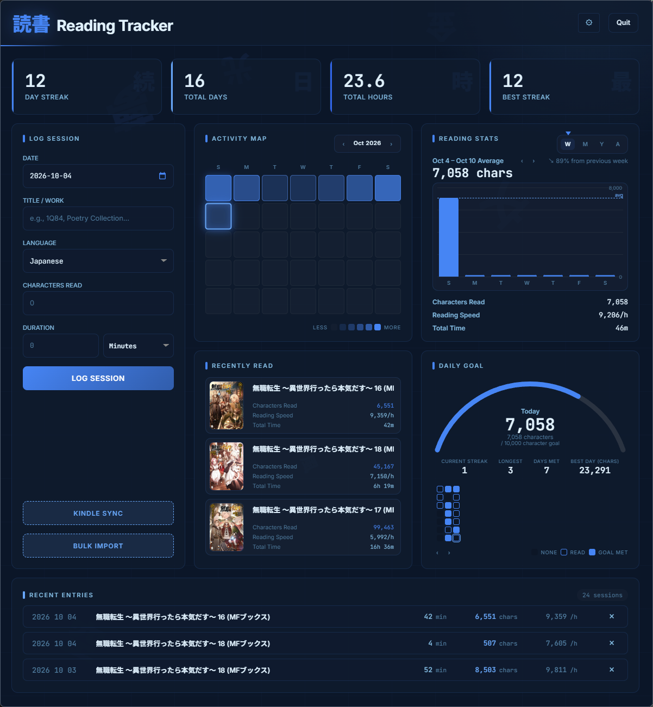
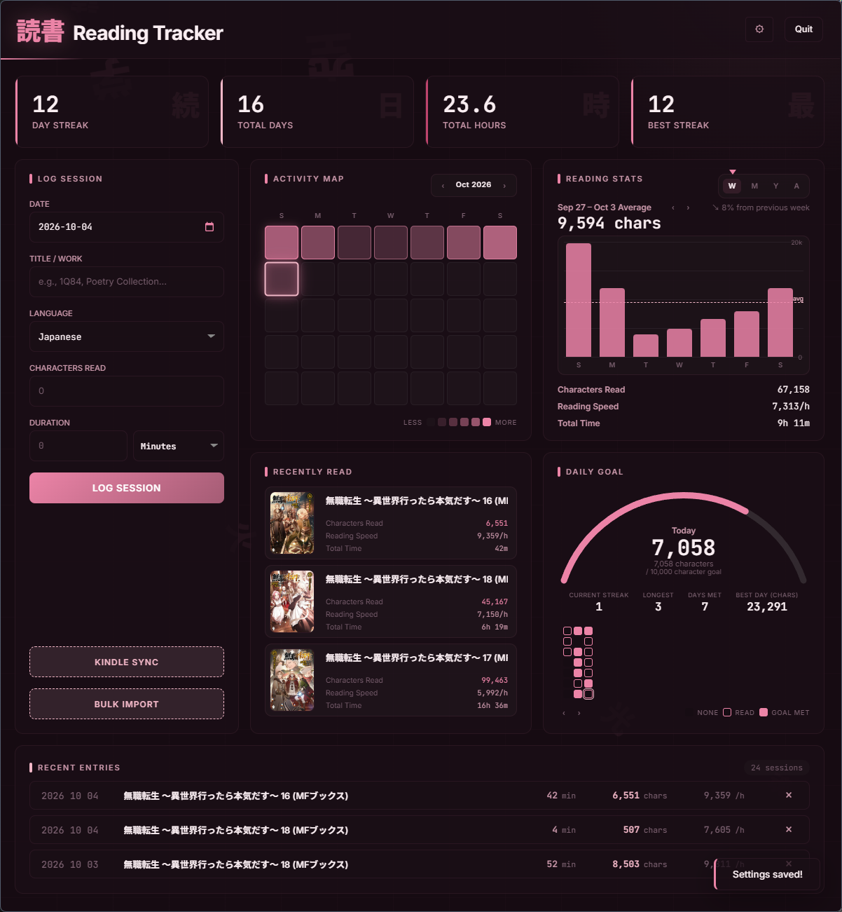

# 読書 — Reading Tracker

<table>
  <tr>
    <td></td>
    <td></td>
  </tr>
</table>

A minimal Electron desktop app for tracking reading sessions with SQLite storage.

## Origin

Little project started mostly as a test for the capabilities of ~~Qwen 3.6 35B A3B~~*, turned out pretty nice. *Friendship ended with 3.6, now 3.8 Flash Next is my best friend

At first I tried to use the built-in Kindle reading stats to make a reading streak plugin, only to discover the stats are completely broken for Japanese books. My monkey brain does like streak calendars and I do want to force myself to read more, so I still wanted to make something along that idea.

By manually placing `krs.start` and `krs.end` notes on the books I'm reading on my Kindle, I can extract the date and hour of each note as well as its position. Using those and a DRM-free copy of the book, I can then extract the exact character count as well. With those three, I can get an accurate-ish measurement of my reading habits, and procrastinate reading by vibe-coding an app that probably already exists.

## Functionalities

- **Reading Session Tracking** — Log sessions by date, title, language, and duration
- **Stats and also Stats** - Reading stats! Stats of your reading!!
- **Bulk CSV Import** — Import multiple sessions at once via CSV with flexible column mapping
- **Kindle Sync** — Pull sidecar and book data from a jailbroken Kindle via SSH and extract reading sessions
- **Database Backup & Restore** — Export/import the whole SQLite database by hand, plus an automatic snapshot at app start whenever the data changed

## Kindle Sync

Requires you to manually add notes containing `krs.start` and `krs.end` when you start and end your reading sessions.
This app does not use the Kindle's built-in reading statistics. Use [kindle-reading-dashboard](https://github.com/zevisvei/kindle-reading-dashboard) for that.

Kindle sidecar parsing and sync scripts are heavily inspired by [kindle-reading-dashboard](https://github.com/zevisvei/kindle-reading-dashboard). This project relies on [KRDS](https://github.com/K-R-D-S/KRDS) for sidecar data extraction and utilizes the kfxlib from the koreader plugin: [kaikozlov/kindle.koplugin](https://github.com/kaikozlov/kindle.koplugin).

#### Kindle Sync Setup

1. deDRM your books :)
2. Ensure your Kindle is jailbroken and has SSH enabled
3. Click the ⚙ icon (top-right) to enter Kindle host and credentials
4. Click "Kindle Sync" to pull sidecar data and extract reading sessions

#### Kindle Sync Settings

| Field             | Default          | Description                                             |
| ----------------- | ---------------- | ------------------------------------------------------- |
| Kindle Host       | `192.168.15.244` | Kindle's local IP address                               |
| Kindle User       | `root`           | SSH username                                            |
| Password          | `kindle`         | SSH password                                            |
| Session Day Ends At | `04:00`        | Sessions ending after midnight before this time are counted as the previous day; `00:00` disables that |

## Database Backup & Restore

The ⚙ menu buttons are manual: export writes the entire SQLite file to the place you choose, and restore swaps the live database for the file you pick (the app reads the file first and refuses anything without a `sessions` table). A restore replaces the current database, it does not merge.

Automatic backups:

- One snapshot is taken when the app starts, and only when the current database differs from the newest snapshot already on disk — an unchanged launch writes nothing.
- Snapshots live in `backups/` next to `data.db` inside the app-data folder (`%APPDATA%\reading-tracker` on Windows), named `data-YYYY-MM-DD-HH-MM-SS.db` so the folder lists as a timeline.
- Only the 10 newest snapshots are kept; older ones are deleted. Files you put in that folder yourself are never touched.
- A snapshot is `data.db` only. Cover images under `covers/` and `settings.json` (Kindle credentials, CSV import settings) are not part of it; manual export of the database file is the way to move everything you chose.
- SQLite journaling does leave `data.db-wal` and `data.db-shm` beside the **live** database — the write-ahead log (pages waiting to be folded in) and its fixed-size index. They are transient bookkeeping, hold no reading data on their own, and the app never leaves such a pair beside a snapshot.

## Setup

#### if using Kindle Sync

Install Python 3.8+ for your platform: https://www.python.org/downloads/

install the dependencies:

```bash
pip install -r python-bundle/requirements.txt --target python-bundle/python/Lib/site-packages
```

#### Electron App

```bash
npm install
npm start
```

```bash
npm install
npm run build:nsis
```

### Database Location

- Windows: `%APPDATA%\reading-tracker\data.db`

### Acknowledgments

[kindle-reading-dashboard](https://github.com/zevisvei/kindle-reading-dashboard) - Served as basis for almost the entire Kindle Sync logic.

[KRDS](https://github.com/K-R-D-S/KRDS) - Handles the parsing of all Kindle sidecar data.

[kaikozlov/kindle.koplugin](https://github.com/kaikozlov/kindle.koplugin) - I snitched their kfxlib folder!

[Hoshi-Reader-Desktop](https://github.com/Manhhao/Hoshi-Reader-Desktop) - I snitched their stats layout ideas!
